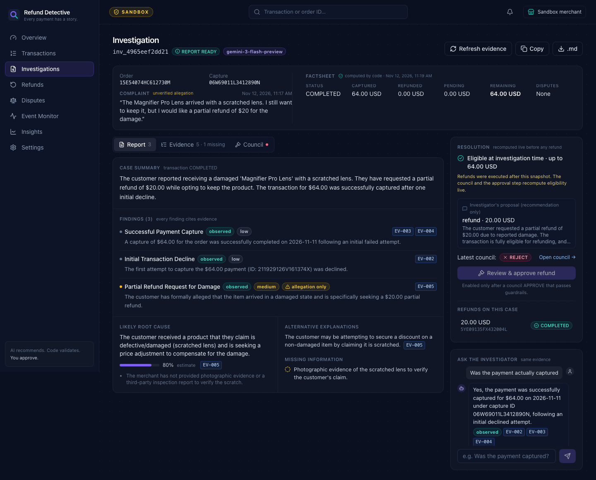

# Refund Detective

**Every payment has a story. Let AI investigate it.**

Refund Detective is an AI-powered payment investigation and resolution platform for PayPal merchants. It gathers real PayPal evidence, explains what happened, debates the right resolution through an adversarial AI review, and executes eligible refunds only with explicit merchant approval.

Built for the PayPal AI Hackathon 2026 on the **PayPal Developer Sandbox**. No real money moves.



## What makes it different

1. **Evidence-first investigator.** The backend collects the order, captures, refunds, disputes and verified webhook events from PayPal and labels each one `EV-001`, `EV-002` and so on. The AI must cite an evidence ID for every finding. Code deletes any finding that cites nothing or cites an ID that doesn't exist, and the UI shows "uncited claim removed".
2. **Adversarial Decision Council.** For every money-moving decision, an **Advocate** argues 100% for and a **Challenger** argues 100% against. They run in parallel, can't see each other's arguments, and use different models. An impartial **Judge** then rules. Deterministic guardrails run after the Judge and can only make the outcome *stricter*.
3. **Controlled resolution.** A refund requires all of the following:
   - a council APPROVE that passed the guardrails;
   - a live re-check against PayPal;
   - a lock on the capture;
   - an idempotency key, with only one refund allowed per approval;
   - explicit merchant confirmation on a button labelled with the exact amount.

   It then executes once via `create_refund`, is verified with `get_refund`, and is written to the audit log.

> AI recommends. Code validates. You approve.

## What was verified live (PayPal Sandbox, 2026-11-11/12)

| Check | Result |
|---|---|
| Backend-owned `@paypal/mcp` child process | `PayPal 1.11.0`, 28 tools discovered, all 9 allowlisted tools present |
| Real data | 3 Sandbox orders created, approved by a Sandbox buyer and captured. `list_transactions`, `get_order`, `get_refund` and `list_disputes` all work through MCP. |
| Investigation | Gemini reports in which every finding cites evidence. The FactSheet is respected, and lookups stay within the allowlist. |
| Decision Council | APPROVE on a USD 20.00 partial refund (Judge confidence 0.95, guardrails passed). REJECT on a USD 64.00 over-refund: the Challenger cited the completed refund, and nothing was executable. |
| **Real Sandbox refund** | `5YE09135FX432004L`: USD 20.00 on capture `06W69011L3412890N`, **COMPLETED**, verified with `get_refund`, with the full audit trail |
| Idempotency | Replaying the same approval returned `409 ALREADY_EXECUTED` without calling PayPal |
| Tests | 139 server and 26 client tests (Vitest) |

The full build log, with the bugs found during live verification, is in [docs/status.md](docs/status.md).

## Quick start (about 10 minutes)

### Prerequisites
- Node.js 20 or later (22 recommended) and npm
- A [PayPal Developer](https://developer.paypal.com) account with a **Sandbox** REST app
- A Google AI Studio API key for Gemini (free tier works), from https://aistudio.google.com/apikey

### 1. Install
```bash
git clone <this repo> refund-detective && cd refund-detective
npm install
cp .env.example .env
```

### 2. Configure `.env`
| Variable | Required | Notes |
|---|---|---|
| `PAYPAL_ENVIRONMENT` | yes | Must be `SANDBOX`. The server refuses to start otherwise. |
| `PAYPAL_CLIENT_ID`, `PAYPAL_CLIENT_SECRET` | yes | Sandbox app credentials. Tokens are minted and refreshed automatically. |
| `AI_PROVIDER` | yes | `gemini` (verified), `anthropic`, or `openai` (any OpenAI-compatible endpoint) |
| `GEMINI_API_KEY` | for Gemini | Or `ANTHROPIC_API_KEY`, or `OPENAI_API_KEY` with `OPENAI_BASE_URL` |
| `AI_MODEL_*` | no | Per-role model overrides. Leave blank for the defaults. |
| `PAYPAL_WEBHOOK_ID` | no | Enables verified PayPal webhooks as investigation evidence (see below) |
| `COUNCIL_REBUTTAL` | no | `true` adds one rebuttal round |
| `DATABASE_PATH`, `PORT` | no | Defaults: `./data/refund-detective.db` and `3001` |

If `list_transactions` returns 403, enable **Transaction Search** for your Sandbox app in the PayPal Developer Dashboard and regenerate credentials. The app shows this hint rather than faking data.

Check the AI key (read-only; it makes one tiny call per model):
```bash
npm run check:ai
```

### 3. Run
```bash
npm run dev          # API on :3001, UI on http://localhost:5173
```
Production mode is a single process that serves the built UI and the API:
```bash
npm run build && npm start   # http://localhost:3001
```

### 4. Get Sandbox data
Use any captured Sandbox payment, or create demo orders. **This writes to PayPal Sandbox.**
```bash
npm run seed:sandbox -- create     # creates 3 USD orders and prints approval links
# Approve each link while logged in as a Sandbox PERSONAL (buyer) account, in a private window.
# Use a US buyer: a buyer account in another currency/country is often declined.
npm run seed:sandbox -- capture    # captures the approved orders
npm run test:sandbox               # read-only live smoke test
```

### 5. Walk through it
1. **Transactions** → pick a captured payment → **Investigate with AI** → describe the complaint.
2. Read the cited findings. Click any `EV-###` chip to jump to that evidence in the timeline.
3. **Decision Council** → set the amount → **Convene council**. Watch the Advocate and Challenger, then the Judge and guardrails.
4. If the outcome is APPROVE, click **Review & approve refund**. The modal re-checks with PayPal live. Tick **I authorize this Sandbox refund** and press **Refund USD 20.00**.
5. Convene a council again for more than the remaining amount. The guardrails will cap or reject it.

### No PayPal credentials?
The app starts in **Demo mode**: clearly labelled sample rows (IDs start with `DEMO-`) and a banner on every page. Investigations, councils and refunds are disabled, because they must never act on sample data.

### PayPal webhooks (optional)
```bash
cloudflared tunnel --url http://localhost:3001     # or: ngrok http 3001
```
Add `https://<tunnel>/api/webhooks/paypal` as a webhook on your Sandbox app (PAYMENT.CAPTURE.\* and CUSTOMER.DISPUTE.\*), then set `PAYPAL_WEBHOOK_ID`. Every event is verified with PayPal's `verify-webhook-signature`. Unverified events are stored but never used as evidence. Without a webhook ID, investigations list webhooks as missing evidence, and nothing is simulated.

## Deploy (Render)
[`render.yaml`](render.yaml) defines one web service: `npm ci && npm run build`, then `npm start`. Set `PAYPAL_CLIENT_ID`, `PAYPAL_CLIENT_SECRET` and `GEMINI_API_KEY` in the Render dashboard. The MCP child process runs inside the same service. On the free plan the SQLite file is ephemeral; attach a disk and set `DATABASE_PATH` to keep data.

## AI models and developer tools

| What | How it is used |
|---|---|
| **Google Gemini** (OpenAI-compatible endpoint) | The product's AI. Investigator: `gemini-3.5-flash`. Advocate: `gemini-3.5-flash`. Challenger: `gemini-3-flash-preview`. Judge: `gemini-3.6-flash`. Each role has its own fallback model, and the two parallel agents never share one. All outputs are JSON validated with Zod, with one retry on invalid output. |
| **PayPal MCP server** (`@paypal/mcp`, agent toolkit 1.11.0) | The PayPal integration. The backend spawns and owns it over stdio. Reads: `list_transactions`, `get_order`, `get_refund`, `list_disputes`, `get_dispute`. Approval-gated writes: `create_refund`, `accept_dispute_claim`. Seeding: `create_order`, `pay_order`. |
| **PayPal REST API** (Sandbox) | OAuth client credentials, webhook signature verification, and a fallback used only when the MCP server is down (Settings shows which path served each call) |
| **Claude Code** (Anthropic, Claude Opus 5.5) | The AI coding assistant used to design, implement, test and document this project |
| Anthropic adapter | Implemented as an alternative provider (`AI_PROVIDER=anthropic`) but **not verified live**, because no Anthropic key was used |
| Node 22, TypeScript, Express 5, Zod 4, better-sqlite3, pino | Backend |
| React 19, Vite, Tailwind CSS 4, TanStack Query, Recharts, lucide-react | Frontend |
| Vitest, Supertest, Testing Library, headless Chrome (CDP) | Tests, plus screenshots and responsive checks at 390px |

## Safety design (short version)
- **Sandbox only.** The base URL is hard-coded and boot fails for anything but `SANDBOX`.
- **The browser never sees credentials or the MCP server.** pino redacts token-like fields, and secret-looking strings are scrubbed from error messages.
- **Strict MCP tool allowlist,** with arguments validated against the schema the server advertises. Writes need an explicit `approved: true` flag that only the approval flows set.
- **Prompt-injection containment:**
  - All free text is wrapped in `<untrusted>` tags, with closing tags neutralised.
  - Investigator lookups may only use IDs already present in the PayPal evidence.
  - A test uses a mock Judge that *obeys* an injected "approve" instruction; the guardrails still reject.
- **Refunds:**
  - The amounts are recomputed from live PayPal data before both the council and the approval.
  - `create_refund` is never retried.
  - An unknown outcome is reconciled through Transaction Search and `get_refund`, and it blocks new refunds until resolved.
- **Personal data:** payer names, emails, addresses and phone numbers are redacted before evidence is stored or sent to the AI.

## Known limitations (honest list)
- **Gemini free tier:** about 20 requests per model per day, plus per-minute limits. Each investigation uses 2–3 calls and each council 3. The app retries with backoff and falls back to other models. When a quota is exhausted it shows `AI_RATE_LIMITED` with the provider's retry time and fakes nothing.
- **PayPal `get_order` does not list refunds.** The app finds refunds through `get_refund` (for refunds it created) and the capture status. A refund made outside the app is detected via `PARTIALLY_REFUNDED`, and further refunds are then **blocked** rather than calculated from incomplete data.
- **No idempotency key on MCP `create_refund`.** Idempotency is enforced in the app: a unique key per refund row, one refund per approval, and a lock. The REST fallback sends `PayPal-Request-Id`.
- **`@paypal/mcp`'s `accept_dispute_claim`** validates `note` against an ID-style regex, so the app sends a slug-style note.
- **Not tested end to end against PayPal:**
  - the dispute accept flow (the Sandbox account has no disputes; covered by tests);
  - webhooks (no tunnel was configured; signature verification is covered by tests).
- **Transaction Search** can lag by hours in Sandbox. The explorer merges in orders the app created, fetched live.
- **Single-merchant demo:** there are no user accounts or authentication. `approved_by` is recorded as `merchant`.

## Docs
- [Architecture](docs/architecture.md)
- [PayPal MCP tool inventory](docs/paypal-mcp-tool-inventory.md)
- [Investigation methodology](docs/investigation-methodology.md)
- [Decision Council](docs/decision-council.md)
- [Demo script](docs/demo-script.md)
- [Devpost submission draft](docs/devpost-submission.md)
- [Build status and acceptance checklist](docs/status.md)

## License
[MIT](LICENSE)
