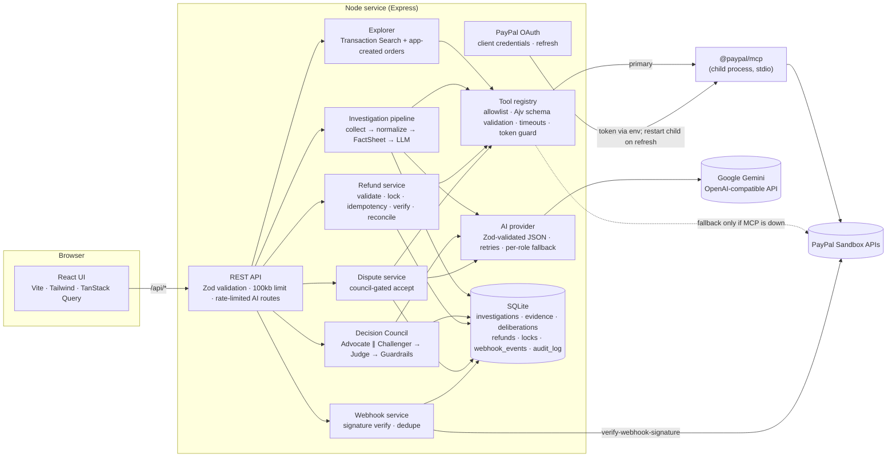
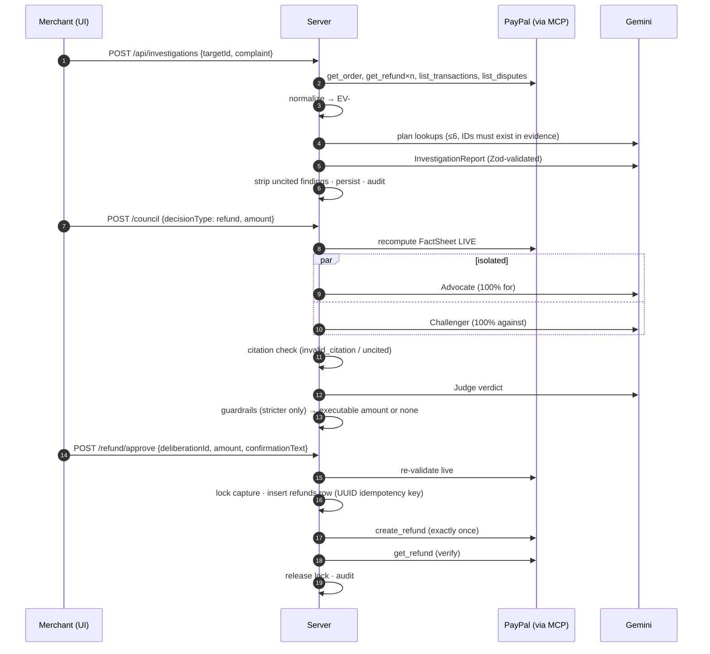

# Architecture

Refund Detective is a single Node service. Express serves the built React client and the JSON API, and it owns a `@paypal/mcp` child process over stdio. State lives in SQLite. There are no queues or microservices.

## Request flow: from complaint to verified refund

## Key modules

| Path | Responsibility |
|---|---|
| `server/src/config.ts` | Env parsing (Zod), the **Sandbox-only guard**, per-provider model defaults and per-role fallbacks |
| `server/src/services/paypal/paypal-auth.ts` | OAuth client credentials, refresh 5 minutes before expiry with retry and backoff, `isStale()` / `invalidate()` |
| `server/src/services/paypal/paypal-mcp-client.ts` | Spawns `node @paypal/mcp --tools=all` with the token in env, `listTools()`, restart with backoff, 15s/30s timeouts, clean shutdown |
| `server/src/services/paypal/paypal-tool-registry.ts` | Allowlist, Ajv validation against the advertised `inputSchema`, write gate, token guard (refresh before calls; one 401 recovery for reads only), REST fallback selection |
| `server/src/services/paypal/paypal-rest-fallback.ts` | The same operations over REST; used only when MCP is unavailable *before* a call |
| `server/src/services/investigation/` | `evidence.ts` (collection, redaction, EV IDs), `rules.ts` (FactSheet, pure), `money.ts` (minor units), `investigator.ts` (lookups, report), `prompts.ts` (safety rules, untrusted wrapping) |
| `server/src/services/council/` | `advocate.ts`, `challenger.ts`, `judge.ts` (prompts), `council.ts` (orchestration), `schemas.ts` (Zod schemas and citation check), `guardrails.ts` |
| `server/src/services/refund/refund.service.ts` | Validate, approve, reconcile |
| `server/src/services/dispute/dispute-resolution.service.ts` | Dispute list, detail and cited summary; council-gated accept |
| `server/src/services/paypal/paypal-webhook.service.ts` | Signature verification, dedupe, related-ID linking |
| `server/src/database/migrations/*.sql` | Schema, applied on boot |
| `client/src/pages/InvestigationWorkspace.tsx` | Three-panel workspace (case, report and timeline, chat and resolution) plus the council panel |

## Data model
Migrations `001`–`004` create:
- `investigations` (with a real `stage` for UI polling)
- `evidence` (redacted payloads)
- `deliberations` (proposal, both arguments, rebuttals, judge, guardrails, live FactSheet, executable amount)
- `refunds` (`idempotency_key UNIQUE`, unique per `deliberation_id`)
- `operation_locks`
- `webhook_events` (`paypal_event_id UNIQUE`, `related_ids`)
- `dispute_actions` (unique per deliberation)
- `investigation_messages`
- `insight_summaries`
- `audit_log` (actor `merchant | system | ai:<role>`)
- `demo_orders` (orders this app created in Sandbox)

## Why the FactSheet is recomputed so often
State can change between the investigation, the council and the approval. A refund may happen elsewhere, or a dispute may open. The FactSheet is a pure function of live PayPal data plus the app's own records. It is recomputed live at three points: when the council starts (for the guardrails), when the approval modal opens, and inside `approve`, right before `create_refund`.
